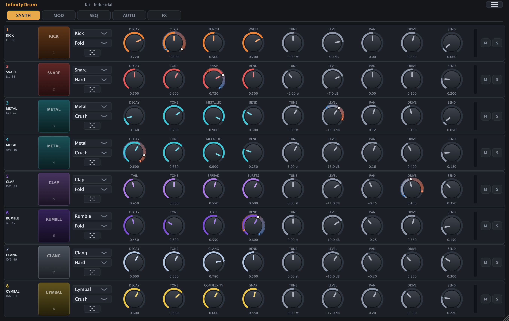

# InfinityDrum

An 8-track drum and percussion **VST3 and Audio Unit instrument**. Every track can load any of its
**synthesis engines**, covering conventional drum synthesis through to inharmonic metal,
wavefolding and sub drones. There are no samples anywhere in the plugin.

Tracks are triggered over MIDI using either the General MIDI drum map or an Arturia
BeatStep Pro's note numbers. Each track has its own distortion curve, drive, tune, pan,
level and reverb send, and every continuous parameter can be varied by velocity.



*Knobs with a velocity depth dialled in show a coloured band for the range velocity can
reach, and a dot for where the last hit actually landed.*

---

## Installing

Prebuilt packages are on the [releases page](https://github.com/fferri/InfinityDrum/releases).
Each one is built and tested on its own platform before it is published.

### macOS

Download `InfinityDrum-macOS-universal.zip`, unzip it, and run the installer that sits next to
the plugin:

```sh
./install-macos.sh
```

That installs both formats where DAWs look for them and clears the **quarantine** flag:

| Format | Goes to |
|---|---|
| VST3 | `~/Library/Audio/Plug-Ins/VST3/InfinityDrum.vst3` |
| Audio Unit | `~/Library/Audio/Plug-Ins/Components/InfinityDrum.component` |

The flag is the part that matters: a browser download sets it, and Gatekeeper refuses to
load quarantined code, so without this step most DAWs will not see the plugins at all.

Pass a path to install only the VST3 somewhere else, or do it by hand instead:

```sh
./install-macos.sh /Library/Audio/Plug-Ins/VST3

# or, by hand:
xattr -dr com.apple.quarantine ~/Library/Audio/Plug-Ins/VST3/InfinityDrum.vst3
xattr -dr com.apple.quarantine ~/Library/Audio/Plug-Ins/Components/InfinityDrum.component
```

One binary covers both Intel and Apple Silicon. It is not notarised — that needs a paid
Apple Developer account — so the quarantine step is unavoidable for a browser download.
Downloading from a terminal (`curl`, `gh release download`) sets no flag at all.

The Audio Unit is validated with Apple's own `auval` before the package is built, so it is
known to load in a host rather than merely to have compiled.

### Windows

Download `InfinityDrum-Windows-x64.zip` and copy the `InfinityDrum.vst3` folder into your VST3
folder, normally:

```
C:\Program Files\Common Files\VST3
```

Windows SmartScreen may warn about the file until it builds up download reputation. A
self-signed certificate does not help with that either.

### Building from source

If you would rather build it yourself, see [AGENTS.md](AGENTS.md#building).

---

## Using it

### The window

Every page that lists tracks puts the same block at the left of each row: the track number,
its engine, its MIDI note, and the pad you can click to play it. Changing page does not move
it, so you always know which row you are looking at.

A bar across the top holds the wordmark, the name of the kit currently loaded, and the menu
button at the far right.

Under it are four page tabs — **SYNTH**, **MOD**, **SEQ** and **FX** — and then the eight
tracks, one to a row.

Each track row, left to right:

- **Track number and note** — the track's number, its engine, and the MIDI note that
  triggers it.
- **Pad** — click to audition. The click's vertical position sets the velocity, soft at the
  top and hard at the bottom. The pad lights up on MIDI hits too.
- **Engine selector** — swaps the synthesis engine, loading that engine's own defaults so
  the track is immediately playable.
- **Distortion curve** — the saturation shape applied by the Drive knob.
- **Four macro knobs** — `Decay`, `Tone`, `Character`, `Sweep`. Each one means something
  specific to the engine, and the captions change to match.
- **Five per-track knobs** — `Tune`, `Level`, `Pan`, `Drive`, `Send`.
- **`M` / `S`** — mute and solo, with a level meter beside them.
- **`RND`** — rolls new settings for that machine.

Double-click any knob to return it to its default.

### The pages

**SYNTH** is where you shape the sound, and where the plugin opens.

**MOD** is where you set how far velocity moves each knob. On this page a drag anywhere on a
knob edits its depth rather than its value — the same thing the rim drag does on the SYNTH
page, but with a far larger target. Every row goes hot while you are there, so the mode is
never ambiguous.

**SEQ** holds one sequencer lane per track — see below.

**FX** holds the shared reverb. It used to sit in the top bar; moving it here is what freed
the space for the sequencer.

### The engines

Each engine is a different way of making sound, not a preset of the others. Pick whichever
suits the part.

| Engine | Good for | Character |
|---|---|---|
| **Kick** | Kicks, 808 bass drums | Deep body, adjustable click and pitch sweep |
| **Snare** | Snares, rimshots | Shell tone plus noise, from tight to ringing |
| **Membrane** | Toms, congas, woodblocks | Tuned percussion, tonal through to inharmonic |
| **Metal** | Closed and open hats, shakers | Bright and metallic, filterable down to noise |
| **Clap** | Claps, snaps | A burst of noise with a tail |
| **Cymbal** | Crashes, rides | Complex and shimmering, with a stick attack |
| **FM Perc** | Cowbells, claves, bells | Clean struck tones, from simple to clangorous |
| **Clang** | Atonal struck metal, industrial percussion | Dissonant by construction, from bell to torn metal |
| **Rumble** | Kick tails, sub drones, tension beds | Very low and long, up to twelve seconds |

The four macro knobs are relabelled for whichever engine is loaded:

| Engine | Decay | Tone | Character | Sweep |
|--------|-------|------|-----------|-------|
| Kick | body decay | beater click | punch | sweep depth |
| Snare | body decay | noise colour | snap | shell bend |
| Membrane | decay | bright | material | bend |
| Metal | decay | filter | metallic ⟷ noise | bend |
| Clap | tail | tone | spread | burst count |
| Cymbal | decay | filter | complexity | snap |
| FM Perc | decay | tone | ratio | index |
| Clang | decay | filter | inharmonicity | bend |
| Rumble | decay | filter | grit | bend |

### Distortion curves

Every track has a **Drive** amount and a curve that shapes it. The curves are
level-compensated, so raising Drive changes the character rather than the loudness.

| Curve | What it sounds like |
|-------|---------------------|
| **Soft** | Warm. The default, and subtle until pushed |
| **Hard** | Crunchier, with a blunt edge |
| **Fold** | Metallic and unstable, shifting with level |
| **Fuzz** | Thick and dirty |
| **Crush** | Digital and aliased, by design |

Drive at 0 is a true bypass whatever curve is selected.

### Velocity response

Every continuous per-track parameter — the four macros plus `Tune`, `Level`, `Drive`, `Pan`
and `Send` — can be swept by velocity. Each gets its own bipolar **depth**, so one knob can
go from barely responsive to a full sweep in either direction.

The curve is anchored at **velocity 100**, the value most controllers send by default:

| Velocity | Effect |
|---|---|
| 127 | the full depth above the dialled value |
| **100** | the knob exactly as dialled, whatever the depth |
| 0 | the full depth below it |

Depth at 0 means velocity does not affect that parameter at all, so a track is completely
flat until you ask for dynamics. Modulation is latched at note-on, so a ringing hit keeps
the character it was struck with while other tracks move on.

A modulated knob shows three things: the **pointer** at the value you dialled, a coloured
**band** spanning every position velocity can reach, and a **dot** where the most recent hit
actually landed. The band is a gradient, cool for a soft hit and hot for a hard one, and it
is coloured by velocity rather than by screen position — so a negative depth visibly
*reverses* the gradient rather than merely sliding it.

| Gesture | Effect |
|---|---|
| Drag the **rim** of a knob | sets that knob's velocity depth |
| Switch to the **MOD** tab, then drag anywhere on a knob | the same, with a much larger target |
| Double-click the rim | resets that depth to 0 |
| Right-click a knob | reset, clear this track, or clear every track |

The MOD page tints every row and switches the numeric readouts over to the depth, so there
is no mistaking which page you are on. The bands themselves are drawn on every page, so you
can see a knob's velocity range while you set its value.

### `RND`

**`RND`** rolls new settings for that machine, picking values each engine actually sounds
good in rather than anything within range — a kick with no sweep is only a click, and
rumble below about 0.4 is not rumble. Tuning moves by musical intervals rather than freely,
so a rolled machine cannot beat against the rest of the kit.

Three things are left alone, deliberately:

- **The engine.** Choosing one is part of how you set a track up, and replacing it would
  discard that choice; the button varies the machine you have.
- **Level, mute and solo.** They are mix decisions, and changing them would undo the balance
  of the kit you are working in.

### Kits

The kit selector in the header loads a complete setup — engines, curves, tunings, levels,
pans, sends and velocity depths — in one go. Every track stays editable afterwards.

Twenty-five kits ship with it:

| Lane | Kits |
|---|---|
| Industrial | Scrapyard, Furnace, Rivet Gun, Collapse, Concrete |
| IDM | Sinew, Halflife, Glass Teeth, Dowel, Static Bloom |
| Electronica | Cassette, Marimba Room, Night Bus, Paper Cup, Sodium |
| Techno | Techno, Hard Techno |
| Ambient | Drift, Ember, Glacier, Sediment, Tin Roof Rain |

alongside three originals: **Industrial** (the default), **Warehouse** and **Studio**.

**Click the kit name** in the top bar, or open the main menu at the top right and choose
**Kit**. Both give the same list: built-in kits and your own in one place.

**Built-in kits are read-only and are not copied to disk**, so a later version of InfinityDrum
can improve them and you get the improvement automatically. Saving always makes a kit of
your own: with a built-in kit loaded, Save pre-fills "<name> Copy", so turning a factory kit
into an editable one is one click.

**Save current settings as a kit...** snapshots everything dialled in. **Import a kit
file...** loads a `.dfkit` from anywhere on disk and adds it to your library. **Export the
current kit...** writes one out.

Your own kits are individual files, so they survive updates, can be backed up and can be
handed to someone else:

```
~/Library/InfinityDrum/Kits/*.dfkit
```

They are plain XML and can be edited by hand. Saving over an existing name replaces it, and
deleting moves the file to the trash rather than destroying it.

### MIDI note maps

By default tracks follow the **General MIDI** percussion map, with the usual aliases folded
onto the same tracks so GM drum files play back correctly:

| Track | Primary note | GM instrument |
|-------|--------------|---------------|
| 1 | 36 (C1) | Bass drum |
| 2 | 38 (D1) | Acoustic snare |
| 3 | 42 (F#1) | Closed hi-hat |
| 4 | 46 (A#1) | Open hi-hat |
| 5 | 39 (D#1) | Hand clap |
| 6 | 45 (A1) | Low tom |
| 7 | 49 (C#2) | Crash cymbal |
| 8 | 51 (D#2) | Ride cymbal |

Closed and pedal hi-hats choke the open hi-hat, as in General MIDI. Unmapped notes are
ignored.

#### Using a BeatStep Pro

An Arturia BeatStep Pro's drum sequencer does not send GM notes. Its pads send
`39, 37, 51, 52, 60, 66, 58, 83`, which is a different language — and one that *collides*
with GM, since note 39 is a hand clap in General MIDI and the first pad on a BeatStep.

So this is a switch, not a union. Open the main menu and choose **MIDI note map → BeatStep
Pro**:

| Track | GM | BeatStep Pro |
|---|---|---|
| 1 | 36 | 39 |
| 2 | 38 | 37 |
| 3 | 42 | 51 |
| 4 | 46 | 52 |
| 5 | 39 | 60 |
| 6 | 45 | 66 |
| 7 | 49 | 58 |
| 8 | 51 | 83 |

Each map ignores the others' notes, so note 36 does nothing while the BeatStep map is
selected. The note number shown in each track's row follows the choice.

#### Other controllers

If your controller just sends an ascending run of eight notes, choose **Chromatic from C3**.
Track 1 is the note the plugin calls C3 — MIDI 60 — and the eight tracks are the eight notes
above it, 60 to 67, with no aliases.

The map is saved with your session, and a new instance starts on whichever map you chose
last.

---

### The sequencer

Every track has **one trigger sequencer**, and it is either a **grid** or a **Euclidean**
pattern. An **On** checkbox under the track name enables it; new lanes start enabled, so
the switch is there to silence one rather than to wake it up.

- **Speed** — a multiplier of a 1/16 note. Bigger is faster.
- **Steps** — how many steps before the pattern repeats, 1 to 64.

Independent length and speed per track is what produces polymeters: a 5-step lane against a
7-step lane at the same speed drifts and realigns on its own.

| Multiplier | Step length | At 120 BPM |
|---|---|---|
| ×1/8 | a 1/2 note | 1000 ms |
| ×1/4 | a 1/4 note | 500 ms |
| ×1/3 | a 3/16 note | 375 ms |
| ×1/2 | a 1/8 note | 250 ms |
| **×1** | a 1/16 note | 125 ms |
| ×2 | a 1/32 note | 62.5 ms |
| ×3 | a 1/48 note | 41.7 ms |
| ×4 | a 1/64 note | 31.3 ms |
| ×6 | a 1/96 note | 20.8 ms |
| ×8 | a 1/128 note | 15.6 ms |

The odd ratios are the point: ×1/3 and ×3 give triplet feels against straight lanes on the
same bar.

Speed always means speed — the lane is switched off by its own checkbox, so the control never
does double duty.

Each lane draws a **playhead**: a line that walks across the steps as the cycle runs, so you
can see at a glance where every lane is, and how lanes of different lengths drift against
each other.

Each grid step carries its **own velocity**. Click a step to switch it on or off; drag it up
or down to set how hard it fires. The step is drawn as an outline when it is enabled, with a
bar filling upward from the bottom to show its velocity, so a row of steps reads as a picture
of the dynamics.

New steps default to **100**, which is the value most controllers send and the point the
velocity curve treats as neutral. Dragging onto an empty step switches it on at that velocity,
so you can play a pattern in rather than toggling first.

In **Euclidean** mode the row also shows:

- **Trigs** — how many pulses to spread across the steps, 0 to the length.
- **Offset** — where the pattern starts, from −length to +length. A negative offset walks it
  backwards, which is the quickest way to get a different feel from the same pulse count.

### The automation page

Rhythm and movement are separate decisions, so they live on separate pages. **AUTO** gives
each track up to **four automation lanes**, each a breakpoint envelope sweeping one
parameter:

- **A tab per parameter** across the top of the lane — `Decay`, `Tone`, `Character`, `Sweep`,
  `Tune`, `Level`, `Drive`, `Pan`, `Send` — so all nine are visible at once. The current tab
  is outlined; the ones with automation running are filled, so the row shows what is being
  automated without you having to look.
- **On** — whether the selected lane runs, under the track name. Automation lanes start **off**,
  because four ramps per track sweeping from the moment you open the plugin is not a
  sensible default.
- **Speed** and **Steps** — its own, so each lane loops on its own length, independently of
  the track's trigger sequencer and of every other parameter's lane.
- **Amount** — how far the envelope moves the parameter.

Each parameter has exactly one lane, which is why the tabs can stand in for a target
selector: the lane you are editing *is* the parameter.

Click in the envelope to add a breakpoint, drag one to move it. Lanes aimed at the same
parameter add up, and the result is layered on top of whatever the knob and the velocity
modulation are already doing.

The automation page works on its own: a track can have no rhythm at all and still have its
parameters moving.

The sequencer follows the host's transport: it starts when you press play and stops when you
stop. A lane never fires on the first block after you press play, so starting mid-bar does
not dump a step into the buffer, and seeking past a run of steps does not fire them all at
once.

**Everything on these pages is saved with your session.** Patterns and envelopes come back
exactly as you left them. They are deliberately *not* part of a kit: a kit is a sound, and a
pattern is an arrangement. Loading someone's kit should not overwrite the groove you wrote.

---

## Licensing

InfinityDrum is released under the **GNU Affero General Public License v3.0** (AGPLv3).

The full licence text is in [LICENSE](LICENSE), and at
<https://www.gnu.org/licenses/agpl-3.0.html>.

The plugin links [JUCE](https://juce.com), which is itself dual-licensed under the AGPLv3
or a commercial licence. Distributing InfinityDrum under the AGPLv3 satisfies JUCE's terms;
shipping it as a closed-source product would require a commercial JUCE licence from Raw
Material Software.

---

## Supporting this project

InfinityDrum is a vibe-coded project. It was built by describing what it should do, and the
code, the kit design and this documentation were produced through that process. That is
enough to arrive at a usable instrument, but it is not a substitute for the judgement of
people who make music with it.

If you would like to see it developed further — more engines, more kits, fewer rough edges —
you can buy me a coffee. It sounds like a small gesture, but one coffee is roughly the
number of tokens it takes to design, implement and verify another feature, so it converts
fairly directly into more of the project:

- **GitHub Sponsors** — <https://github.com/sponsors/fferri>

Bug reports and feature requests are equally welcome and cost nothing. They are tracked in
the [issue tracker](https://github.com/fferri/InfinityDrum/issues).
